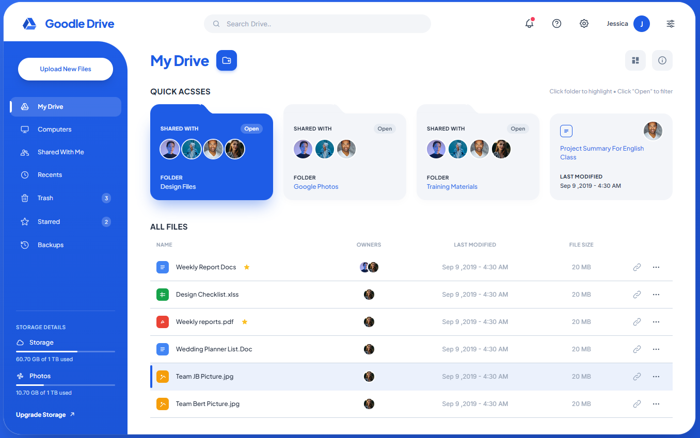

# Goodle Drive — Cloud Storage UI

Template dashboard penyimpanan cloud yang dibuat dengan HTML, CSS, dan JavaScript. Desain biru dengan sidebar melengkung, kartu folder, dan daftar file interaktif.

[**Buka demo**](https://laluarifta.github.io/goodle_drive_cloud_storage_ui/)

## Preview



## Menjalankan

Clone repository lalu buka `index.html` di browser:

```bash
git clone https://github.com/LALUARIFTA/goodle_drive_cloud_storage_ui.git
cd goodle_drive_cloud_storage_ui
```

Atau jalankan server lokal jika Python tersedia:

```bash
python -m http.server 8000
```

Buka <http://localhost:8000>. Tidak diperlukan backend untuk mencoba template.

## Struktur

```text
.
├── index.html          # Halaman utama
├── assets/
│   ├── css/            # Stylesheet frontend
│   ├── js/             # Logika interaksi dashboard
│   └── img/
│       └── preview.png # Preview untuk README
├── .gitignore
└── README.md
```

## Fitur antarmuka

- Layout responsif dengan menu sidebar untuk layar kecil.
- Pencarian file, filter folder, serta tampilan daftar dan grid.
- Navigasi My Drive, Computers, Shared With Me, Recents, Trash, Starred, dan Backups.
- Preview file, penandaan bintang, serta pengelolaan sampah dalam sesi demo.

## Kustomisasi

- Ubah struktur halaman dan identitas produk di `index.html`.
- Ubah warna dan tampilan di `assets/css/`.
- Ubah data contoh dan perilaku dashboard di `assets/js/app.js`.
- Ganti `assets/img/preview.png` untuk memperbarui screenshot README.

## Publikasi

Repository ini disajikan melalui **GitHub Pages**, dari branch `main` dan folder `/` (root). Semua path aset relatif sehingga dapat digunakan pada project site GitHub Pages maupun hosting statis lain.

Untuk repository hasil fork, aktifkan **Settings → Pages → Deploy from a branch → main → / (root)**, lalu perbarui URL demo pada README.

## Batasan

Ini **template frontend/demo**, bukan layanan Google Drive dan tidak berafiliasi dengan Google. Data contoh dan perubahan interaksi berada di memori browser dan kembali ke awal setelah halaman dimuat ulang. Upload, sinkronisasi, backup, berbagi, dan informasi kapasitas tidak menyediakan penyimpanan cloud nyata. Jangan gunakan untuk menyimpan data penting tanpa backend, autentikasi, dan kontrol akses yang sesuai.

Font dari Google Fonts dan foto contoh dari Unsplash memerlukan koneksi internet.
